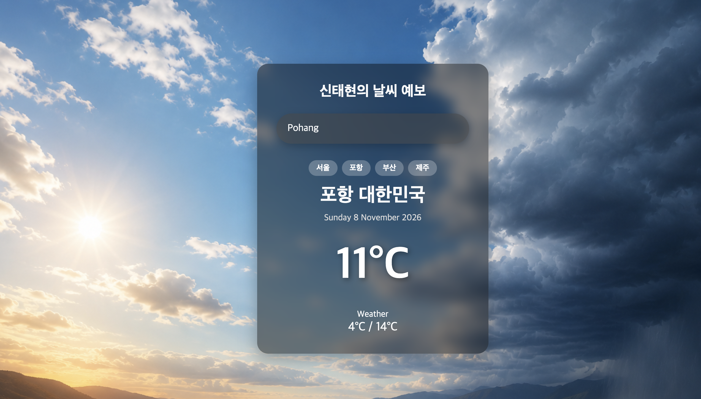

## 📌 STEP 1. Open Source Project 선택

작성자: 22101046 신태현
배포 URL: https://taehyeon-weather.vercel.app/
과제 저장소: https://github.com/2026-2-OSS/assign10-c02-22101046.git
원본 출처: https://github.com/fshoja/React-Weather-App
 (MIT License)


### 1) 프로젝트 선택 이유
- React와 Vite 기반의 간단한 구조로 되어 있어, React의 핵심 개념인 컴포넌트 생명주기와 React Hooks(`useState`, `useEffect`)를 분석하고 학습하기에 매우 적합하여 선택했습니다.
- 백엔드 서버나 데이터베이스 구축 없이 공개 오픈 API(Open-Meteo)를 직접 호출하므로, Vercel 배포 및 독립적인 구동이 용이합니다.
- MIT 라이선스가 적용되어 있어 오픈소스 수정 및 재배포가 자유롭습니다.

### 2) 주요 기능 (3가지)
1. 도시명 기반 실시간 날씨 검색: 사용자가 입력한 도시의 실시간 기온 및 날씨 정보 조회
2. 최저/최고 기온 표시: 당일 예보 데이터를 바탕으로 최저 및 최고 기온 출력
3. 위치 및 날짜 포맷팅: 검색된 도시·국가 정보와 현재 날짜를 포맷팅하여 화면에 렌더링


'''
## STEP 2. Clone & Run

프로젝트 설치 및 로컬 실행 방법:

bash
# 1. 저장소 클론
git clone https://github.com/2026-2-OSS/assign10-c02-22101046.git
# 2. 프로젝트 폴더로 이동 
cd assign10-c02-22101046
# 3. 의존성 패키지 설치
npm install
# 4. 개발 서버 실행
npm run dev
'''

## STEP 3. Source code Exploration

1) project Structure (주요 파일의 역할)

- src/main.jsx: React 애플리케이션의 진입점(Entry Point)으로, HTML의 #root 엘리먼트에 최상위 <App /> 컴포넌트를 마운트합니다.

-src/App.jsx: 애플리케이션의 최상위 루트 컴포넌트로, 메인 날씨 화면을 렌더링하는 Weaterapp 컴포넌트를 호출합니다.
  
- src/component/Weaterapp.jsx: 날씨 검색, API 데이터 호출, 상태 관리, 화면 렌더링을 모두 담당하는 핵심 메인 컴포넌트입니다.

- data.jsx: 요일, 날짜, 월, 연도를 사람이 읽기 쉬운 문자열로 포맷팅해 주는 showDate() 유틸리티 함수를 제공합니다.


2) React Component 역할
App 컴포넌트 (src/App.jsx): 애플리케이션의 최상위 루트 컨테이너 역할을 하며, 하위의 Weaterapp 컴포넌트를 화면에 마운트합니다.
Weaterapp 컴포넌트 (src/component/Weaterapp.jsx):

    상태 관리(useState): 사용자의 입력 도시(inputCity, city), 날씨 데이터(posts), 에러 상태(error)를 총괄 관리합니다.
    비동기 통신(useEffect): 검색 도시가 변경될 때마다 Open-Meteo API를 호출하여 최신 날씨 데이터를 가져옵니다.
    조건부 렌더링: 날씨 데이터가 정상일 때는 날씨 카드를 렌더링하고, 도시를 찾지 못하면 에러 UI를 렌더링합니다.


3) Code Analysis (코드 분석 및 동작 원리)
jsx
// src/component/Weaterapp.jsx 내 날씨 조회 비동기 로직
const geo = await fetch(
  `https://geocoding-api.open-meteo.com/v1/search?name=${city}&count=1&language=ko`
);
const geoData = await geo.json();
if (!geoData.results) {
  setError(true);
  return;
}
const { latitude, longitude, name, country } = geoData.results[0];
const weather = await fetch(
  `https://api.open-meteo.com/v1/forecast?latitude=${latitude}&longitude=${longitude}&current=temperature_2m,weather_code&daily=temperature_2m_max,temperature_2m_min&timezone=auto`
);
const weatherData = await weather.json();

동작 원리 설명:
1. 사용자가 입력한 도시 이름(city)을 가지고 Open-Meteo Geocoding API를 호출하여 해당 도시의 위도(latitude)와 경도(longitude) 좌표를 먼저 구합니다.
2. 검색 결과가 없으면 setError(true)를 호출하여 'City not found' 에러 화면을 띄웁니다.
3. 좌표를 정상적으로 받아오면 해당 위도·경도 값을 넘겨 Forecast API를 호출하여 현재 기온, 최저/최고 기온을 받아와 상태(posts)에 저장하고 화면을 갱신합니다.


### STEP 4. Customizing
 기존 오픈소스 프로젝트에서 Text, Style, UI/Data 3가지 유형을 각각 다음과 같이 커스터마이징하였습니다.

1) Text 커스터마이징 (src/component/Weaterapp.jsx)
상단 제목 추가: 기존 프로젝트에는 상단 타이틀이 없었으나, 본인의 이름을 반영하여 <h1 className="app-title">신태현의 날씨 예보</h1>라는 제목을 화면 최상단에 새롭게 추가하였습니다.
검색창 문구 한글화: 영문 입력 안내 문구(placeholder="Search for a city...")를 국내 사용자가 직관적으로 이해할 수 있도록 placeholder="도시 입력 후 Enter"로 변경하였습니다.

2) Style 커스터마이징 (src/component/Weaterapp.css)
타이틀 전용 CSS 스타일 정의: 새로 추가한 상단 제목이 배경과 잘 어울리도록 .app-title 스타일 클래스를 추가하였습니다.
폰트 크기를 26px로 키우고 굵게(bold) 처리하였으며, 가독성을 위해 글자색을 흰색(white)으로 지정하고 하단 여백(margin-bottom: 24px)을 부여하였습니다.

3) UI / Data 커스터마이징 (src/component/Weaterapp.jsx)
기본 검색 도시 변경: 기존에 외국의 'iran'으로 고정되어 있던 기본 조회 도시를 국내 사용자에 맞추어 'Pohang'(포항)으로 변경하였습니다.
검색 폼 제출 방식 개선: 키 입력 시마다 API를 호출하는 비효율을 방지하기 위해 <form onSubmit> 이벤트를 적용하여 Enter 키를 눌렀을 때만 검색되도록 개선하였습니다.
한글 도시명 검색 지원 (데이터 매핑): '서울', '포항', '부산', '대구', '제주' 등 한국어 도시명을 입력해도 영문 도시명으로 자동 변환해 검색을 수행하는 cityNames 매핑 객체 데이터를 추가하였습니다.
주요 도시 빠른 선택 버튼 UI 추가: 검색창 하단에 클릭 한 번으로 도시 기온을 즉시 조회할 수 있는 [서울] [포항] [부산] [제주] 4개의 퀵 버튼을 새롭게 추가하였습니다.

### Weekly Review:

### 배운내용
새롭게 배운 내용 3가지
오픈소스 Git 워크플로우와 다중 리모트(Multi-Remote) 관리:
오픈소스를 내 GitHub 계정으로 포크(Fork)한 뒤, 로컬 작업 공간에서 원본 저장소(upstream), 내 포크 저장소(origin), 그리고 과제 제출 저장소(assignment)를 각각 리모트로 등록하여 체계적으로 소스코드를 관리하고 푸시하는 실전 오픈소스 협업 흐름을 배웠습니다.

Git Commit의 본질과 세이브 포인트 개념:
커밋은 로컬 컴퓨터에 남기는 작업 일지이자 세이브 포인트이고, 푸시는 이를 클라우드에 최종 업로드하는 단계라는 명확한 차이를 깨달았습니다. 특히 feat:, docs:, fix: 같은 커밋 컨벤션을 활용해 작업 단위별로 의미 있는 기록을 남기는 것이 개발 과정을 증명하는 강력한 무기가 된다는 점을 배웠습니다.

React 비동기 데이터 통신과 조건부 렌더링:
useState와 useEffect 훅을 활용하여 Geocoding API로 도시의 위도·경도 좌표를 먼저 조회한 뒤, 그 좌표로 날씨 예보 API를 연계 호출하는 비동기(async/await) 처리 흐름을 분석했습니다. 또한 데이터 수신 여부에 따라 날씨 카드 또는 에러 화면을 분기 처리하는 조건부 렌더링 방식을 실습을 통해 깊이 이해했습니다.

### 어려웠던 점
어려웠던 점: 기존 프로젝트에 빠른 선택 버튼을 추가하고 코드를 수정하는 과정에서 실수로 태그 짝이 맞지 않아 Vite 화면에 JSX 파싱 에러(Expected corresponding JSX closing tag)가 발생하여 화면이 멈추는 문제를 겪었습니다. 또한 처음에 어떤 저장소로 클론하고 푸시해야 하는지 Git 구조가 헷갈려 혼란스러웠습니다.


해결 방법: 터미널 에러 로그에 표시된 파일 경로와 줄 번호를 확인하여 지워졌던 <header>와 <form> 태그를 제자리에 복구하여 문법 오류를 깔끔하게 해결했습니다. 저장소 문제는 git remote -v 명령어로 원격 주소 목록을 확인하고, 내 포크 레포와 교수님 레포의 역할을 분리하여 단계별로 커밋을 쌓은 뒤 한 번에 푸시하는 방식으로 안전하게 해결했습니다.

AI 활용 내용:
AI에게 코드를 통째로 맡기지 않고, "어느 파일의 몇 번째 줄을 어떻게 수정해야 하는지"와 "터미널에서 어떤 명령어를 사용해야 하는지" 가이드를 받는 페어 프로그래밍 파트너로 활용했습니다. 특히 내가 수정한 코드와 작성한 README 설명 사이에 불일치(검색창 누락, 0°C 표시 오류 등)가 없는지 사전에 꼼꼼하게 검증받는 코드 리뷰 도구로 유용하게 활용했습니다.
느낀 점:
처음 오픈소스 프로젝트를 내려받았을 때는 남이 짠 코드라 낯설고 막막했지만, 코드를 하나하나 뜯어보면서 상단에 내 이름을 달고, 기본 도시를 포항으로 바꾸고, 클릭 한 번으로 도시가 바뀌는 퀵 버튼을 직접 만들어 넣으면서 "오픈소스를 내 입맛대로 이것저것 커스터마이징하는 게 이렇게 재미있는 거구나!" 하는 성취감을 크게 느꼈습니다. 에러를 직접 잡아가며 10개 가까운 커밋을 내 손으로 차곡차곡 쌓아 올려 Vercel에 배포까지 성공하고 나니, 개발에 대한 자신감이 한층 더 커진 매우 유익한 실습이었습니다.


### AI 도움을 받은 부분과 직접 수행한 작업을 사실대로 기록.


AI에게 받은 도움 (지적 및 제안받은 내용)
코드 관련 지적 사항:
빠른 선택 버튼을 넣는 과정에서 실수로 검색창(input) 코드가 지워진 사실을 지적받음
상단 제목(h1) 코드가 73줄과 75줄에 중복으로 두 번 들어가 있는 것을 지적받음
현재 기온이 정확히 0°C일 때 조건부 연산자 오류로 --로 표시되는 잠재적 버그(!= null 조건 필요) 지적
README 및 서식 교정 지원:
마크다운 코드 블록 백틱(```) 기호 누락 및 설치 명령어에 cd assign10-c02-22101046이 빠져 있던 점을 교정받음
"실시간 갱신" 대신 "조회 시점 기온", "기기 기준 날짜" 등 실제 구현에 부합하는 정확한 기술 표현으로 문구를 제안받음


본인이 직접 수행한 일 (실제 작업 내역)
소스코드 직접 수정:
src/component/Weaterapp.jsx: 상단 제목 추가, 검색창 복구, 포항 기본 도시 설정, 한글 도시명 매핑 객체 작성, 주요 도시 빠른 선택 버튼 4개([서울], [포항], [부산], [제주]) UI 직접 구현
src/component/Weaterapp.css: .app-title 스타일 클래스 직접 작성
AI가 지적한 중복 제목 삭제 및 0°C 버그 코드(!= null) 직접 반영
로컬 실행 및 디버깅:
npm run dev를 실행하여 브라우저에서 버튼 클릭 시 날씨가 바뀌는지, 검색창 입력 후 Enter가 잘 작동하는지 직접 테스트 및 오류 확인
Git 버전 관리:
작업 단위마다 의미 있는 메시지를 고민하여 로컬 커밋을 직접 8회 이상 작성 및 세이브
내 포크 저장소(origin)와 교수님 과제 저장소(assignment)로 직접 git push 실행
Vercel 배포:
Vercel 대시보드에서 본인 GitHub 레포지토리를 직접 연결하여 배포 완료 및 정상 구동 확인


## 캡처화면



=======================================================================


# React Weather App 🌤️

A modern and responsive weather application built with React.js and Vite.

The application allows users to search for cities and view real-time weather information using the Open-Meteo API.

## 🚀 Features

- Search weather by city name
- Display current temperature
- Show city and country information
- Display minimum and maximum temperature
- Real-time weather data
- Responsive design for desktop and mobile
- Fast and lightweight application

## 🛠️ Technologies

- React.js
- JavaScript (ES6+)
- HTML5
- CSS3
- Vite
- Open-Meteo API
- React Hooks

## 📦 Installation

Clone the repository:

```bash
git clone https://github.com/fshoja/React-Weather-App.git